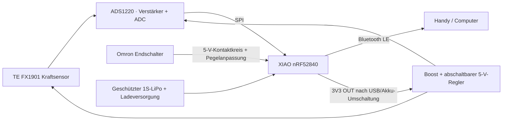

# Bluetooth-Messung für Fingerworker

Stand 11.10.2026. Die vierlagige Rev-A-Platine ist geroutet und besteht die nativen ERC-/DRC-/Netzprüfungen. Firmware und iPhone-App sind implementiert; physische Inbetriebnahme und BLE-Qualifikation stehen aus. Aktuelle Anleitungen: [Firmware](firmware/README.md), [App](ios/README.md), [BLE v3](ios/BLE_PROTOCOL.md). Frühere PDF-/ZIP-Stände sind datierte Entwürfe.

**Empfehlung:** Ein Seeed Studio XIAO nRF52840 liest einen ADS1220-Messwandler und den vorhandenen Endschalter ein. Er überträgt beide Signale per Bluetooth Low Energy an Handy oder Computer. Für einen ersten Tischaufbau reicht USB; ein flacher LiPo ergänzt später den mobilen Betrieb.

## Bausteine

| Baustein | Aufgabe / Auslegung |
|---|---|
| Seeed Studio XIAO nRF52840 | Bluetooth-Controller, 21 × 17,8 mm, USB, SPI und digitale Eingänge; integrierte LiPo-Ladeschaltung. |
| TI ADS1220 | Differenzieller 24-Bit-ADC mit einstellbarer Verstärkung. Analoge Versorgung 5 V, digitale Versorgung 3,3 V; gemeinsame Masse. |
| Vorhandener TE FX1901-0001-0200-L | Kraftsignal an zwei ADC-Eingänge; Sensor mit den empfohlenen 5 V speisen. |
| Vorhandener Omron SS-01GL2 | NC-Kontakt gegen Masse, 4,7-kOhm-Pull-up an 5 V für etwa 1 mA; 2N7002 setzt auf 3,3-V-Logik um. ENDSTOP_N LOW bei Endlage oder Leitungsunterbrechung; Entprellung und Zeitstempel im Controller. |
| Versorgung | Geschützter 100-mAh-LiPo am XIAO, nominal 50-mA-Ladung; Messzweig aus dessen 3V3-Ausgang über TPS61041 und TPS7A2050. Seitentaster für Standby/Wecken; kein zusätzlicher harter Schalter in Rev A. |

Herstellergrundlagen: [Seeed XIAO](https://wiki.seeedstudio.com/XIAO_BLE/), [TI ADS1220](https://www.ti.com/lit/gpn/ADS1220).

## Besonderheit des vorhandenen Kraftsensors

Das TE-Familien-Datenblatt nennt für die **200-lbf-Variante** einen typischen Messhub von **36 mV/V**, mit 34,2–37,8 mV/V Toleranz. Bei 5 V ergeben sich typisch 180 mV; mit maximalem Nullpunktversatz von ±15 mV/V muss der positive Eingang bis etwa **264 mV** abdecken. Das ist deutlich mehr als bei üblichen Waagenmessbrücken. Ein hoch verstärkendes Standard-Waagenmodul wäre deshalb keine sichere Plug-and-play-Auswahl. [TE-Datenblatt, Tabelle für 200 lbf](https://www.te.com/commerce/DocumentDelivery/DDEController?Action=srchrtrv&DocFormat=pdf&DocLang=English&DocNm=FX19&DocType=Data+Sheet&PartCntxt=FX1901-0001-0200-L)

Im Entwurf: **5-V-Referenz aus derselben Sensorversorgung, Verstärkung 8**. Der ADC-Codebereich ist ±625 mV; der PGA-Hub begrenzt ihn bei mittigem Gleichtakt auf ±575 mV. Für das maximale erwartete 264-mV-Signal ist ein Gleichtakt von 1,256 bis 3,744 V nötig. Der echte Sensor-Gleichtakt und die Versorgungsrampen bleiben am Muster zu messen. Rev A spezifiziert den TSSOP-16-Baustein mit getrennter 5-V-Analog- und 3,3-V-Digitalversorgung sowie externen Filtern und Referenz. [TI ADS1220](https://www.ti.com/lit/gpn/ADS1220)

## Daten und App

- Kraft mit beispielsweise 330 Messungen pro Sekunde erfassen; gefilterte Live-Anzeige etwa 25-mal pro Sekunde aktualisieren. Das sind vorgeschlagene Startwerte für einen Prototyp.
- Rohwerte bei Bedarf gebündelt übertragen. Jeder Datensatz enthält laufende Nummer, geräteseitigen Zeitstempel, Kraft in Newton, Schalterzustand und Akkustand. So beeinflusst Funkverzögerung die Zeitachse nicht.
- Steuerbefehle: Aufzeichnung starten/stoppen, unbelasteten Zustand tarieren, Kalibrierung speichern.
- Endschalter mit zunächst 5–10 ms Softwareentprellung testen. Er meldet eine Endlage; einen kontinuierlichen Weg misst er nicht.
- Erst mit **nRF Connect** auf iOS/Android Verbindung und Messwerte prüfen, danach eine einfache App mit Kraftkurve, Spitzenkraft, Haltezeit und CSV-Export erstellen. Eine Internetverbindung ist nicht nötig. [Nordic nRF Connect](https://www.nordicsemi.com/Products/Development-tools/nRF-Connect-for-mobile)

## Kalibrierung und Einbau

Den vollständig montierten Kraftpfad mit mehreren bekannten Kräften kalibrieren und Be-/Entlastung wiederholen. Die Federvorspannung ist im unbelasteten Gerät bereits vorhanden und muss beim Nullabgleich berücksichtigt werden. Die 24-Bit-Auflösung ist keine entsprechende Kraftgenauigkeit; Sensorhysterese, Mechanik, Reibung und Temperatur bestimmen das nutzbare Ergebnis.

Für die flache Bauform Controller, Messplatine und Akku nebeneinander anordnen. Antenne an eine freie Außenkante, kurze differenzielle Sensorleitungen, Akku außerhalb von Feder-, Führungs- und Quetschbereichen. Die optionale Onshape-Bauraumstudie unter der festen Handballenauflage bleibt eine Referenzgeometrie. Der neu gewählte JST-Stecker samt Kabel und der Seitentaster brauchen noch reale Hüllkörper; die bestehenden Kollisionsberichte prüfen diese neuen Teile nicht. Maße und Annahmen stehen in `ELECTRONICS_PACKAGING.md`, der aktuelle Schaltungsstand in `electronics/README.md`.

Aktuelle NC-Verdrahtung, Messsperre vor dem Hartanschlag und Firmware-Abnahme: [electronics/FIRMWARE_CONTRACT.md](electronics/FIRMWARE_CONTRACT.md). Firmware und iPhone-App sind implementiert und kompiliert; Hardwaretest und Kalibrierung stehen noch aus. [Firmware](firmware/README.md), [App/BLE-v3](ios/BLE_PROTOCOL.md).
