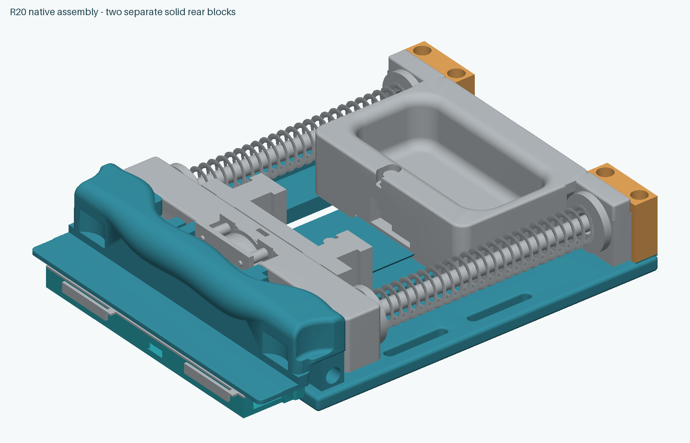
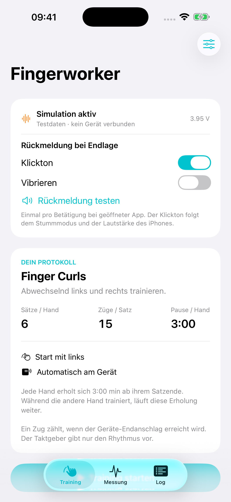
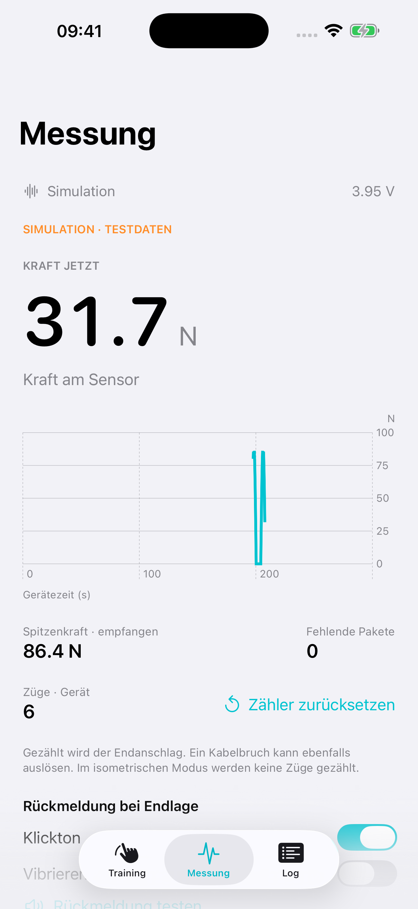
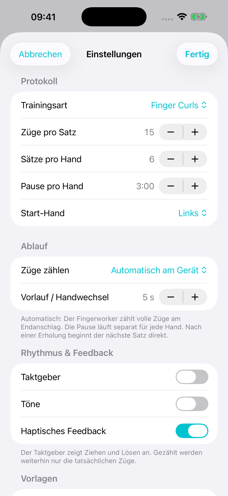

# Fingerworker

[](https://jhilti.github.io/fingerworker/)

**[R31 mit Rev E in 3D ansehen →](https://fingerworker-development-notebook.jonashilti.chatgpt.site/#cad-r31-rev-e)** · [R20-3D-Archiv](https://jhilti.github.io/fingerworker/)

Ein 3D-gedruckter Prototyp für Fingerkrafttraining mit federgeführtem Griff, organischer Handballenauflage und optionaler Kraftmessung. Dieses Repository enthält CAD-Quellen, Firmware, eine iPhone-App, Elektronikentwurf und die Entwicklungshistorie.

*A 3D-printed finger-training prototype with a spring-loaded grip and optional force sensing. The latest documented assembly is Flat132 R31 with Rev E electronics.*

## R31 mit Rev‑E‑Elektronik

**Stand 25.11.2026.** Das vollständige R31-Modell zeigt den Federbetrieb in Ruhestellung mit flacher Handauflage, fester Sensorhaltnase, FX1901-Kraftsensor, Fingerschlitten, Akku und USB-C-Zugang von oben. Je ein verdrahteter Daumentaster sitzt links und rechts am Querbalken. Beide teilen sich den Eingang D7 über J4. Im iOS-Basistraining löst ein kurzer Druck einen Handwechsel aus.

Schaltplan- und Layoutprüfung in KiCad sowie Firmware- und iOS-Build sind abgeschlossen. Passung, Bediengefühl und Handwechsel per Bluetooth stehen am verdrahteten Muster noch zur Prüfung aus.

[Vollständige Baugruppe in Onshape](https://cad.onshape.com/documents/15316cc6370631845af136b2/w/8b79384f95b34ba58197ab08/e/061a7997871e238371c40026) · [Entwicklungsnotizbuch mit drehbarem 3D-Modell](https://fingerworker-development-notebook.jonashilti.chatgpt.site/#cad-r31-rev-e)


## Die App

Screenshots aus dem iOS-Simulator mit simulierten Testdaten.

| Training | Messung | Einstellungen |
| --- | --- | --- |
| [](docs/images/app-training.png) | [](docs/images/app-measurement.png) | [](docs/images/app-settings.png) |
| Geführte Sätze und Handwechsel. | Kraftverlauf und Messwerte. | Trainingsart, Umfang und Pausen. |

## Modell ansehen

- **[R20-3D-Ansicht direkt öffnen](https://jhilti.github.io/fingerworker/)** – öffentliche interaktive Ansicht zum Teilen.
- [R20-3D-Ansicht als HTML](share/Fingerworker_R20_3D.html) – herunterladen und offline im Browser öffnen. GitHub zeigt die HTML-Datei auf der Repository-Seite als Quelltext an.
- [Projektübersicht](Uebersicht.html) – lokale Übersicht mit Modell und Dokumentation. Für ihre relativen Verweise das Repository herunterladen.
- [Onshape R20, unveränderliche Version](https://cad.onshape.com/documents/15316cc6370631845af136b2/v/0e06e3d98b9ecb574ee41402/e/d253eb87b70818ebde8215f0) – nativer CAD-Stand des R20-Releases.
- [Release v0.20.0-prototype](https://github.com/jhilti/fingerworker/releases/tag/v0.20.0-prototype) – native CAD-Downloads und Veröffentlichungsstand.

## Veröffentlichter Prototypstand R20

<!-- CURRENT_FLAT132_R20_START -->

Die hinteren Halter P06L und P06R sind separate massive Blöcke. Je ein integrierter **Ø5 × 2 mm Positionierzapfen** gleitet beim axialen Aufschieben in eine hinten offene Nut der Grundplatte. Das ermöglicht einen **federfreien, unbelasteten Passaufbau ohne Schrauben**. Die organische Handballenauflage, beidseitigen Daumenmulden und Durchlässe für zwei 25-mm-Gurte bleiben erhalten. Es gibt keine Vorspannverstellung.

**Vor jeder Federlast, auch der Vorspannung in Ruhestellung, sind vier M3×8-Schrauben in den vorgesehenen Inserts erforderlich.** Die Zapfen verriegeln die Blöcke nicht gegen Herausziehen. R20-Grundplatte und beide R20-Halter gemeinsam verwenden; [Montageanleitung beachten](review/rear-locating-pegs-2026-11-13/MONTAGE.md).

Nominale CAD-Prüfungen sind dokumentiert. Reale Druckpassung, Komfort, Elektronik, Kalibrierung und belastete Funktion bleiben zu prüfen. Es gibt keine validierte Lastfreigabe oder klinische Freigabe; frühere Kraftziele sind keine geprüften Belastbarkeitsangaben.

**Druckvorbereitung pausiert:** PLA ist das vorgesehene Standardmaterial. Für R20 existieren noch kein freigegebenes Bambu-Projekt und kein neuer Slice. Ältere Druckpakete bilden frühere Revisionen ab und enthalten die R20-Änderungen nicht.

<!-- CURRENT_FLAT132_R20_END -->

## CAD herunterladen

- [Native STL-Baugruppe: Flat132_R20_neutral_final.zip](https://github.com/jhilti/fingerworker/releases/download/v0.20.0-prototype/Flat132_R20_neutral_final.zip)
- [Native STEP-Baugruppe: Flat132_R20_final_AP214.step](https://github.com/jhilti/fingerworker/releases/download/v0.20.0-prototype/Flat132_R20_final_AP214.step)
- [FeatureScript-Quelle](fingerworker_mvp.fs) · [R20-Änderungsbericht](review/rear-locating-pegs-2026-11-13/README.md) · [Prüfbindung](review/rear-locating-pegs-2026-11-13/final-specification.json)

Die native STL-Baugruppe enthält auch Referenzhardware und ist kein fertig angeordnetes Druckprojekt. Für lokale Modell-Builds stellt der Download-Helfer das unveränderte ZIP am erwarteten Projektpfad wieder her:

```sh
python3 tools/download_release_assets.py
```

Details stehen in [Veröffentlichung und Wiederherstellung](PUBLISHING.md).

Weitere Downloads im selben Release:

- [R20-3D-Ansicht als ZIP](https://github.com/jhilti/fingerworker/releases/download/v0.20.0-prototype/Fingerworker_R20_3D.zip) – eigenständige HTML-Datei zum Weitergeben.
- [Historische Bambu-Projekte bis R18](https://github.com/jhilti/fingerworker/releases/download/v0.20.0-prototype/Historical_Bambu_Projects_through_R18.zip) – 24 bestehende 3MF-Dateien, ausschließlich historische Stände; **kein R20-Druckpaket**.
- [Historische Metallzeichnungen Rev A](https://github.com/jhilti/fingerworker/releases/download/v0.20.0-prototype/Historical_Mechanical_Drawings_RevA.zip).
- [Technische Elektronikexporte Rev A](https://github.com/jhilti/fingerworker/releases/download/v0.20.0-prototype/Electronics_RevA_Technical_Exports.zip) – dokumentierter Entwicklungsstand, keine Fertigungsfreigabe.

## Projektbereiche

| Bereich | Inhalt |
| --- | --- |
| [Mechanik und Montage](review/rear-locating-pegs-2026-11-13/README.md) | R20-Geometrie, Positionierzapfen, Passungen und nominale Prüfungen |
| [Stückliste](EINKAUFSTEILE.md) | Bauteile, Befestigungen und Revisionshinweise |
| [Firmware](firmware/README.md) | Kraftmessung, Endschalter, BLE und lokale Test-/Build-Werkzeuge |
| [iPhone-App](ios/README.md) | BLE-Anbindung, Trainingsansicht und Sitzungsspeicherung |
| [Elektronik](electronics/kicad/README.md) | KiCad-Schaltplan, Platine und dokumentierter Entwurfsstand |
| [Spezifikation](SPECIFICATION.md) / [offene Arbeiten](GAP_ANALYSIS.md) | Anforderungen und noch ausstehende Hardware-Nachweise |
| [Druckstatus](print/REVISION_STATUS.md) | Zuordnung früherer Druckstände; R20-Druckvorbereitung pausiert |

Firmware, App und Elektronik sind Teil des Prototyps. Eine dokumentierte Softwareprüfung ersetzt keine elektrische oder mechanische Qualifikation des aufgebauten Geräts. Bei historischen Dokumenten gilt die jeweils genannte Revision.

## Umfang der Veröffentlichung

Quellen und technische Entwicklungshistorie bleiben erhalten. Persönliche Bestellungen und Scans, Studien mit persönlichen Referenzen, Laufzeitumgebungen, Hersteller-PDFs/-CAD sowie alte generierte Spiegelkopien sind aus dem öffentlichen Repository ausgenommen. Historische Dokumente können deshalb auf nur lokal vorhandene Dateien verweisen. Details und CAD-Wiederherstellung stehen in [PUBLISHING.md](PUBLISHING.md).

Für die eigenen Projektdateien wurde noch keine Open-Source-Lizenz gewählt. Die Veröffentlichung allein erteilt keine solche Lizenz; gegebenenfalls enthaltene Drittbestandteile behalten ihre jeweiligen Lizenzbedingungen.
