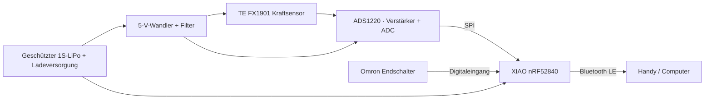

# Bluetooth-Messung für Fingerworker

Stand: 20. September 2026. Schaltungsvorschlag, noch kein aufgebauter oder getesteter Elektronikentwurf.

**Empfehlung:** Ein Seeed Studio XIAO nRF52840 liest einen ADS1220-Messwandler und den vorhandenen Endschalter ein. Er überträgt beide Signale per Bluetooth Low Energy an Handy oder Computer. Für einen ersten Tischaufbau reicht USB; ein flacher LiPo ergänzt später den mobilen Betrieb.

## Bausteine

| Baustein | Aufgabe / Auslegung |
|---|---|
| Seeed Studio XIAO nRF52840 | Bluetooth-Controller, 21 × 17,8 mm, USB, SPI und digitale Eingänge; integrierte LiPo-Ladeschaltung. |
| TI ADS1220 | Differenzieller 24-Bit-ADC mit einstellbarer Verstärkung. Analoge Versorgung 5 V, digitale Versorgung 3,3 V; gemeinsame Masse. |
| Vorhandener TE FX1901-0001-0200-L | Kraftsignal an zwei ADC-Eingänge; Sensor mit den empfohlenen 5 V speisen. |
| Vorhandener Omron SS-01GL2 | Ein Kontakt gegen Masse, 3,3-V-Pull-up am Eingang; Entprellung und Zeitstempel im Controller. |
| Versorgung | Für Akkubetrieb geschützter 1S-LiPo, Ein/Aus-Schalter und geregelte, gefilterte 5 V für den Messzweig. Akku, Strompfad beim Laden und konkrete Platine vor Integration dimensionieren. |

Herstellergrundlagen: [Seeed XIAO](https://wiki.seeedstudio.com/XIAO_BLE/), [TI ADS1220](https://www.ti.com/lit/gpn/ADS1220).

## Besonderheit des vorhandenen Kraftsensors

Das TE-Familien-Datenblatt nennt für die **200-lbf-Variante** einen typischen Messhub von **36 mV/V**, mit 34,2–37,8 mV/V Toleranz. Bei 5 V ergeben sich typisch 180 mV; mit maximalem Nullpunktversatz von ±15 mV/V muss der positive Eingang bis etwa **264 mV** abdecken. Das ist deutlich mehr als bei üblichen Waagenmessbrücken. Ein hoch verstärkendes Standard-Waagenmodul wäre deshalb keine sichere Plug-and-play-Auswahl. [TE-Datenblatt, Tabelle für 200 lbf](https://www.te.com/commerce/DocumentDelivery/DDEController?Action=srchrtrv&DocFormat=pdf&DocLang=English&DocNm=FX19&DocType=Data+Sheet&PartCntxt=FX1901-0001-0200-L)

Mein Ausgangspunkt für den ADS1220: **5-V-Referenz aus derselben Sensorversorgung, Verstärkung 8**. Der rechnerische differentielle Bereich ist dann ±625 mV. Die gemeinsame Versorgung als Referenz reduziert den Einfluss ihrer Schwankungen. Ein konkretes Modul muss getrennte 5-V-Analog- und 3,3-V-Digitalversorgung sowie die externe Referenz unterstützen; das gilt nicht automatisch für jede ADS1220-Platine. Eingangsfilter, Gleichtaktbereich, Einschaltverhalten und Leiterplattenlayout werden beim Schaltungsentwurf geprüft. [TI, Abschnitte 9.1.3, 9.2.3 und 9.3](https://www.ti.com/lit/gpn/ADS1220)

## Daten und App

- Kraft mit beispielsweise 330 Messungen pro Sekunde erfassen; gefilterte Live-Anzeige etwa 25-mal pro Sekunde aktualisieren. Das sind vorgeschlagene Startwerte für einen Prototyp.
- Rohwerte bei Bedarf gebündelt übertragen. Jeder Datensatz enthält laufende Nummer, geräteseitigen Zeitstempel, Kraft in Newton, Schalterzustand und Akkustand. So beeinflusst Funkverzögerung die Zeitachse nicht.
- Steuerbefehle: Aufzeichnung starten/stoppen, unbelasteten Zustand tarieren, Kalibrierung speichern.
- Endschalter mit zunächst 5–10 ms Softwareentprellung testen. Er meldet eine Endlage; einen kontinuierlichen Weg misst er nicht.
- Erst mit **nRF Connect** auf iOS/Android Verbindung und Messwerte prüfen, danach eine einfache App mit Kraftkurve, Spitzenkraft, Haltezeit und CSV-Export erstellen. Eine Internetverbindung ist nicht nötig. [Nordic nRF Connect](https://www.nordicsemi.com/Products/Development-tools/nRF-Connect-for-mobile)

## Kalibrierung und Einbau

Den vollständig montierten Kraftpfad mit mehreren bekannten Kräften kalibrieren und Be-/Entlastung wiederholen. Die Federvorspannung ist im unbelasteten Gerät bereits vorhanden und muss beim Nullabgleich berücksichtigt werden. Die 24-Bit-Auflösung ist keine entsprechende Kraftgenauigkeit; Sensorhysterese, Mechanik, Reibung und Temperatur bestimmen das nutzbare Ergebnis.

Für die flache Bauform Controller, Messplatine und Akku nebeneinander anordnen. Antenne an eine freie Außenkante, kurze differenzielle Sensorleitungen, Akku außerhalb von Feder-, Führungs- und Quetschbereichen. Ein Einbauplatz wird erst mit ausgewähltem Akku und tatsächlichen Platinenabmessungen im CAD festgelegt. Aktuell sind diese Elektronikteile noch nicht im Onshape-Modell integriert.
