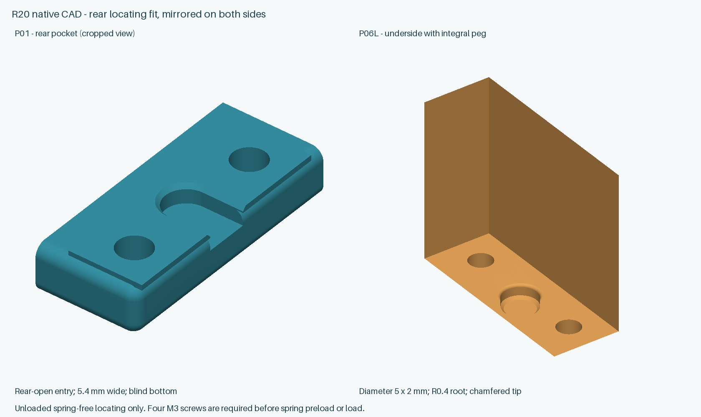

# Flat132 R20 – massive Positionierzapfen

Stand 13.11.2026. **Native R20-CAD-Geometrie geprüft. Druckvorbereitung auf deinen Wunsch zurückgestellt.** Kein neues Bambu-Projekt, kein neuer Slice und kein Druckauftrag.

P06L und P06R besitzen jetzt je einen integrierten **Ø5 × 2 mm Positionierzapfen** an der Unterseite. Die Grundplatte erhält zwei passende, hinten offene Sacknuten: 5,4 mm breit, mit 0,2 mm seitlichem Spiel und 0,3 mm Bodenluft. Der Zapfenansatz ist mit R0,4 gerundet; eine 0,4-mm-Spitzenfase und eine 0,5-mm-Einführung an der Nut erleichtern das Fügen. Keine zusätzlichen Kleinteile oder biegsamen Rastarme.

Die Öffnung nach hinten ist nötig: Beide Stangenenden sitzen in Blindbohrungen. Der Block wird daher axial auf die Stange geschoben, während der Zapfen von hinten in die Nut einfährt. Eine geschlossene Bohrung für senkrechtes Einstecken würde diesen Montageweg versperren.

**Schraubenlos nur federfrei und unbelastet positionieren.** Die offene Nut verriegelt nicht gegen Herausziehen. Bereits vorgespannte Federn belasten die Blöcke in Ruhestellung. Deshalb müssen die vier vorhandenen M3×8 in ihren Inserts fest sitzen, bevor Federkraft oder andere Last freigegeben wird. Die Zapfen sind eine Pass- und Positionierhilfe, kein Ersatz für diese Befestigung.

[Onshape R20](https://cad.onshape.com/documents/15316cc6370631845af136b2/v/0e06e3d98b9ecb574ee41402/e/d253eb87b70818ebde8215f0) · [Native STEP-Baugruppe](native/Flat132_R20_final_AP214.step) · [Native STL-Geometrie](native/Flat132_R20_neutral_final.zip) · [Übersicht](../../Uebersicht.html)

[Montage](MONTAGE.md) · [Review](parts-review.md) · [Stückliste](BOM_Aenderungen.csv) · [Prüfbindung](final-specification.json)

Nur P01/P06L/P06R ändern sich gegenüber R19; die Baugruppe bleibt bei94 Körpern,91 davon geometrisch unverändert. Die organische Handballenauflage, weicheren Daumenmulden, Stangenbohrungen, der30-mm-Hub, Messkraftpfad und Gurtdurchlässe bleiben erhalten. P08 bleibt die optionale, mit zwei M2×8 befestigte Elektronikwanne. PLA bleibt Standard. Reale Passung und Belastbarkeit sind am Ausdruck zu prüfen.
